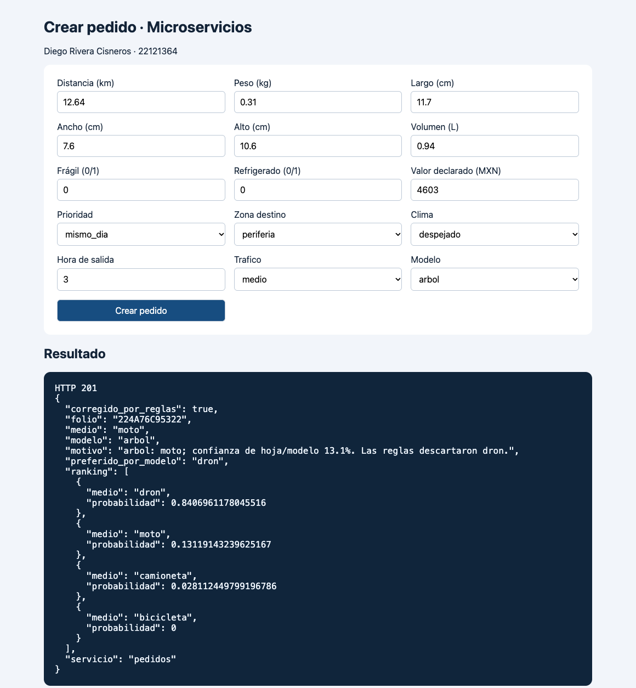
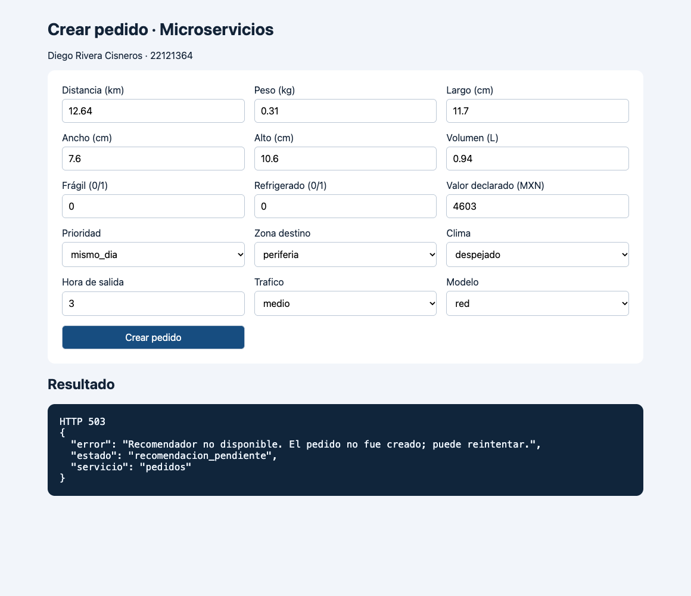
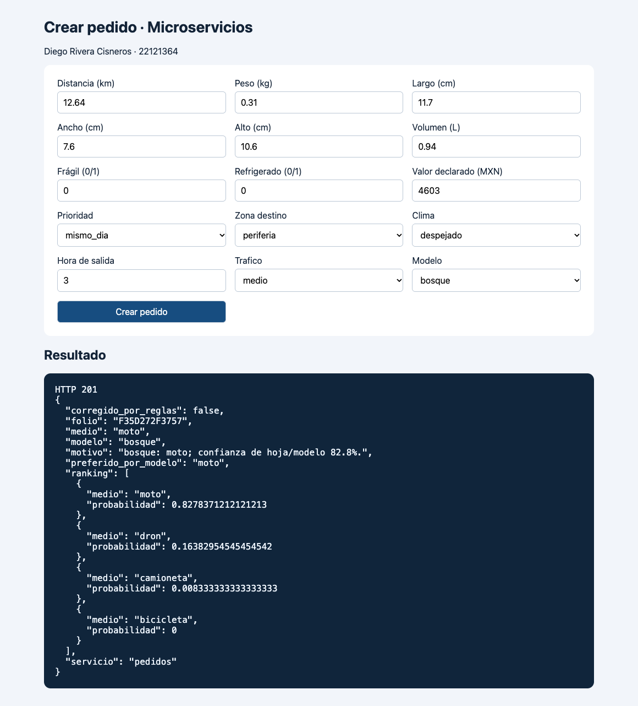
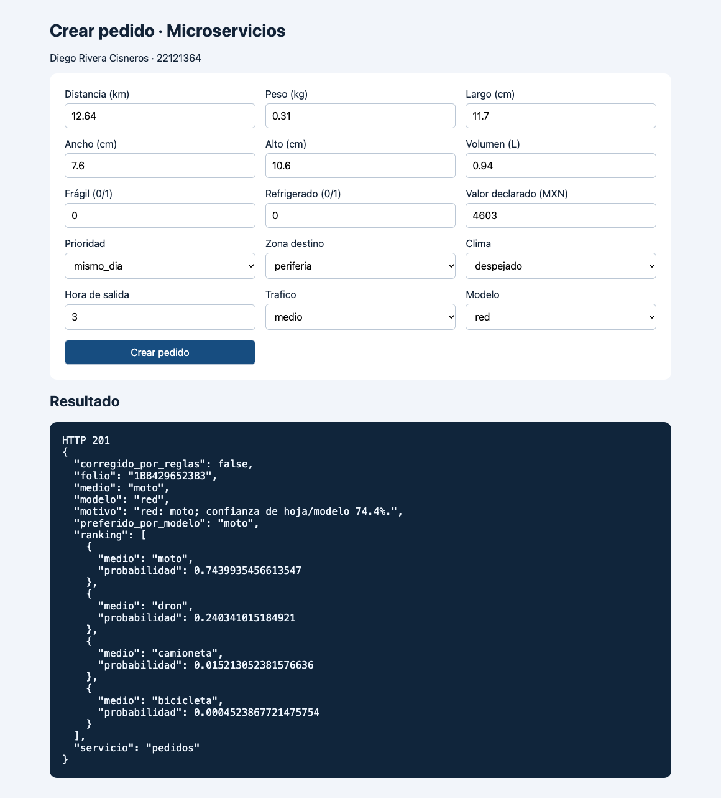

# Actividad — Microservicios con Docker

**Nombre:** Diego Rivera Cisneros  
**Matrícula:** 22121364.

## 1. Predicción (hora 3) frente al resultado del navegador

Para el paquete de 12.64 km, 0.31 kg y 0.94 L, a las 3:00, esperaba que las reglas descartaran el dron aunque el árbol lo prefiriera. Moto puede transportar este paquete: no está refrigerado y cabe dentro de sus límites. El resultado final fue **moto**, HTTP 201, con un folio creado por Pedidos.



El árbol asignó 84.07% al dron, pero las reglas lo descartaron por horario. La probabilidad de moto era 13.12%. Es una puntuación del modelo para esa alternativa; no es una garantía de que un viaje real vaya a salir bien.

## 2. docker compose ps: contenido de cada contenedor

```text
NAME                                IMAGE                             COMMAND                  SERVICE      CREATED              STATUS                        PORTS
topicos22121364micro-gateway-1      nginx:1.28-alpine                 "/docker-entrypoint.…"   gateway      About a minute ago   Up About a minute             127.0.0.1:18080->80/tcp
topicos22121364micro-pedidos-1      topicos22121364micro-pedidos      "gunicorn --bind 0.0…"   pedidos      About a minute ago   Up About a minute (healthy)   8001/tcp
topicos22121364micro-recomendar-1   topicos22121364micro-recomendar   "gunicorn --bind 0.0…"   recomendar   About a minute ago   Up About a minute (healthy)   8002/tcp
```

| Servicio | Responsabilidad | Imagen y dependencias |
| --- | --- | --- |
| gateway | Sirve el formulario y reenvía peticiones. | Nginx, sin lógica de recomendación. |
| pedidos | Llama al recomendador por HTTP, crea folio y guarda en memoria. | Imagen propia con Flask, requests y Gunicorn; no tiene scikit-learn. |
| recomendar | Carga modelos, genera ranking y aplica factibilidad. | Imagen propia con Flask, pandas, joblib y scikit-learn. |

Solo el gateway publica puerto al host. La prueba usó **127.0.0.1:18080**, pues el 8080 ya estaba ocupado. El archivo Compose permite el 8080 por defecto. El [registro de separación](evidencias/separacion-pedidos.txt) comprueba que Pedidos no tiene instalado scikit-learn.

## 3. Fallo al apagar Recomendar

Se detuvo únicamente el contenedor de Recomendar. El formulario continuó visible; al crear otro pedido mostró **HTTP 503**, indicando que el pedido no fue creado y la recomendación quedó pendiente. No se inventó un vehículo sin validar sus límites. Durante la caída, `/salud/pedidos` siguió devolviendo 200 y no aumentó el número de pedidos almacenados.



La [salida de curl durante el fallo](evidencias/curl-recomendar-apagado.txt) registra la misma API. Al arrancar de nuevo Recomendar, se obtuvo nuevamente HTTP 201 sin reiniciar Pedidos ni el gateway. Los timeouts de conexión y lectura acotan la espera del cliente.

## 4. Réplicas de la etapa 5 frente a esta práctica

Las réplicas de Django ejecutan el mismo programa completo y comparten PostgreSQL: reparten carga, pero no separan sus responsabilidades en despliegues distintos. Aquí hay tres procesos con funciones y dependencias diferentes. Pedidos no importa el recomendador y no carga modelos; depende de un contrato HTTP. Apagar Recomendar produce un fallo parcial, no la desaparición del proceso de Pedidos.

Tener tres contenedores no basta por sí solo. La evidencia es el contenido de las imágenes, las llamadas de red y la independencia que se comprobó al detener un componente.

## 5. Camino entre navegador y modelo

```text
Navegador
  ── HTTP POST /pedidos → Gateway :18080
  ── proxy HTTP → Pedidos :8001
  ── HTTP POST http://recomendar:8002/sugerir → Recomendar
       ── llamada en memoria a predict_proba
       ── reglas de factibilidad
  ← ranking viable y motivo
  ← Pedidos crea el folio
  ← respuesta JSON al mismo origen del navegador
```

Los saltos entre contenedores son de red. El acceso al `.joblib`, el DataFrame y la evaluación de reglas ocurren dentro de Recomendar. El [registro de peticiones del navegador](evidencias/peticiones-navegador.json) muestra que el formulario solo usa el origen del gateway y `/pedidos`; no conoce puertos internos.

## 6. Cambio del .joblib

Los modelos se cargan al iniciar Recomendar y se copian a su imagen. Por ello, cambiar el archivo exige reconstruir y recrear **Recomendar** con el artefacto nuevo. Pedidos y gateway no cambian mientras el contrato se mantenga. En un monolito que empaqueta modelo y pedidos en la misma imagen, se actualiza esa unidad completa, aunque podría diseñarse carga de artefactos versionados sin reemplazar todo el código.

La versión de scikit-learn queda fijada a la usada en el entrenamiento: **1.9.1**. Los tres artefactos incluidos se entrenaron con 8,000 filas y se evaluaron con 2,000 filas apartadas; no se cargó un modelo ajeno como evidencia propia.

## 7. Dos límites antes de producción

1. **Persistencia e idempotencia:** Pedidos conserva datos en memoria de un solo worker. Un reinicio los pierde y dos envíos crean dos folios. Harían falta base compartida, transacciones y claves de intento para evitar duplicados.
2. **Control de acceso y operación:** esta práctica es local y no incluye autenticación, autorización por pedido, TLS, rate limiting ni seguimiento distribuido. La salud del proceso no demuestra por sí sola que todas sus dependencias funcionen. Hacen falta métricas, permisos y despliegues de modelos validados.

## 8. HTML frente al del monolito

Ambos presentan un formulario con los catorce datos y un selector de modelo, y muestran folio, medio y motivo. La diferencia está detrás de esa interfaz: aquí `fetch('/pedidos')` llega al gateway y Pedidos consulta otro proceso por HTTP. En el monolito, una vista Django puede resolver recomendador, reglas y medios mediante imports dentro de la misma unidad de despliegue. Una pantalla parecida no demuestra una arquitectura igual.

## 9. Hora 3 con árbol, bosque y red

| Modelo | Preferido por el modelo | Medio final | Corregido por reglas | Folio obtenido |
| --- | --- | --- | --- | --- |
| arbol | dron | moto | Sí | 224A76C95322 |
| bosque | moto | moto | No | F35D272F3757 |
| red | moto | moto | No | 1BB4296523B3 |

Coincidieron en **moto** al final. El árbol necesitó corrección; bosque y red ya preferían moto. Los motivos y probabilidades cambiaron. No se puede concluir que los modelos siempre coincidan por este único ejemplo.





## Validaciones adicionales

Se verificaron respuestas 400 para campos faltantes, modelo inexistente y hora 24; 422 para un paquete de 2,000 kg sin medio viable; y 201 con camioneta para refrigeración. Las respuestas completas constan en [resultados.json](evidencias/resultados.json), y la creación con curl en [curl-normal.txt](evidencias/curl-normal.txt).

**Fuente del enunciado:** [Microservicios con Docker](https://ealcaraz85.github.io/topicoswebmobil/#actividad-microservicios-docker).
