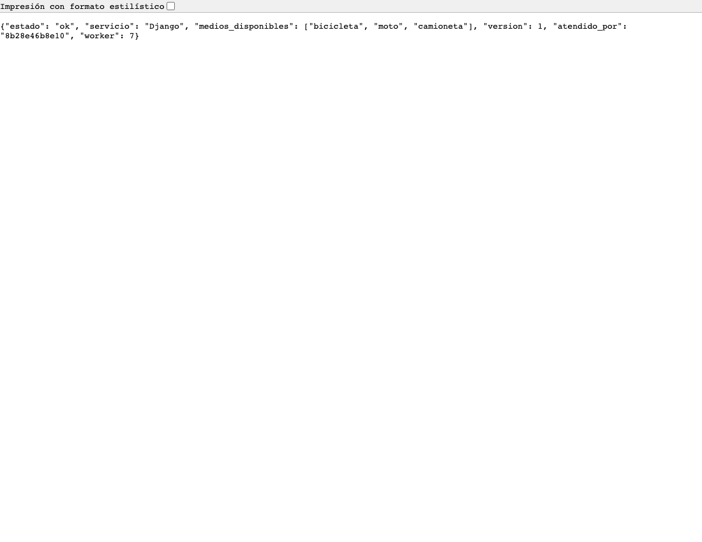
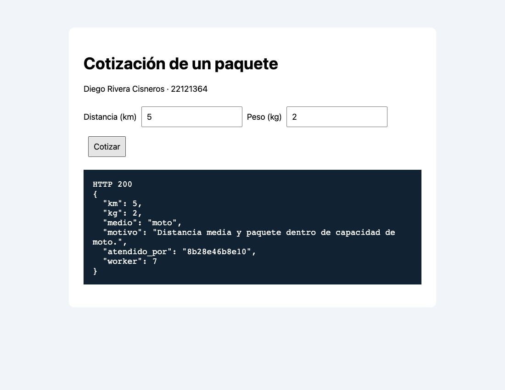
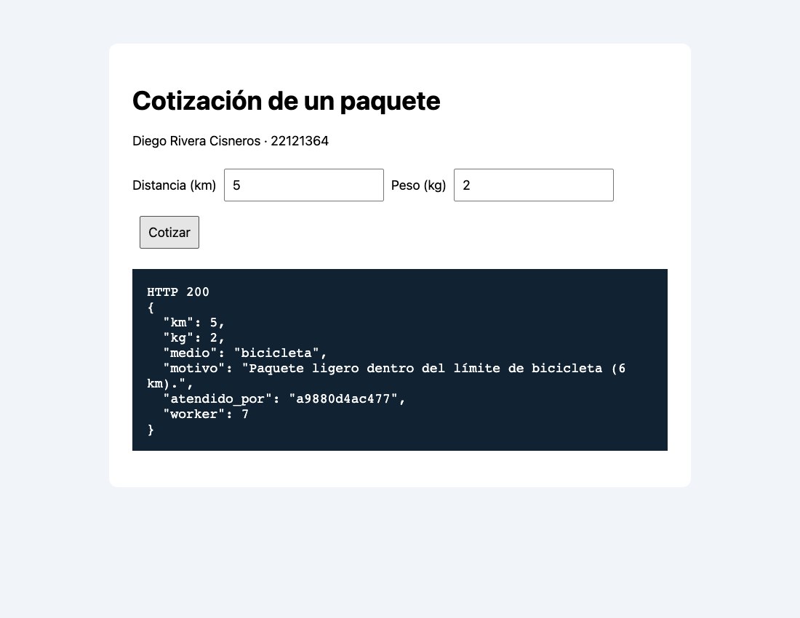

# Retos sobre la ruta de Django

**Nombre:** Diego Rivera Cisneros  
**Matrícula:** 22121364.

## Reto 1. Entorno y estado del servicio

El laboratorio se ejecutó en el equipo de Diego, con entorno virtual para las comprobaciones de Django y contenedores para la prueba de réplicas. No se incluyen evidencias de las computadoras de otros integrantes.

Salida de `python -c "import sys; print(sys.prefix)"`:

```text
/private/tmp/topicos-analisis-venv
```



En macOS se utiliza `python3 -m venv` y `source .venv/bin/activate`; en PowerShell, el activador está en `.venv\Scripts\Activate.ps1`. Esa diferencia es de ruta y shell, no del código de dominio. La imagen ejecuta Gunicorn con dos workers por réplica.

## Reto 2. Cotización JSON y errores

La vista convierte y valida `km` y `kg`; la selección se delega a [reglas.py](practica/entregas/reglas.py). Un paquete mayor de 25 kg o de 40 km usa camioneta; uno de hasta 8 kg dentro del alcance configurado de bicicleta puede usar bici; los restantes usan moto.

| Caso probado | HTTP | Medio o error |
| --- | --- | --- |
| correcta | 200 | moto |
| sin_km | 400 | km y kg son obligatorios y deben ser números finitos no negativos. |
| km_texto | 400 | km y kg son obligatorios y deben ser números finitos no negativos. |
| negativo | 400 | km y kg son obligatorios y deben ser números finitos no negativos. |

La [salida completa](evidencias/cotizaciones.json) conserva los valores de entrada, el motivo y la instancia que atendió. También se rechazan números no finitos. Los errores no crean pedidos.

La validación debe estar en backend porque el navegador se puede omitir y otros clientes pueden enviar texto o negativos. Strategy permitiría separar algoritmos por medio si crecieran; la fábrica seleccionaría cuál construir. Una regla pequeña no exige crear muchas clases de antemano.

## Reto 3. Dos clientes, un backend

El formulario web y [el cliente de terminal](practica/cliente_movil.py) consultan `/entregas/cotizar/?km=5&kg=2`. Con límite de bici de **3 km**, ambos recibieron **moto**. Al cambiar el límite central de la regla a **6 km** mediante su configuración, ambos recibieron **bicicleta**, sin modificar sus archivos.





Salida del cliente de terminal antes:

```json
{
  "km": 5.0,
  "kg": 2.0,
  "medio": "moto",
  "motivo": "Distancia media y paquete dentro de capacidad de moto.",
  "atendido_por": "eaaa3d7fd03b",
  "worker": 8
}
```

Salida del mismo cliente después:

```json
{
  "km": 5.0,
  "kg": 2.0,
  "medio": "bicicleta",
  "motivo": "Paquete ligero dentro del límite de bicicleta (6 km).",
  "atendido_por": "4727c1b2800b",
  "worker": 8
}
```

La regla vive en backend. Si solo hubiera estado en JavaScript, el cliente de Python habría conservado un criterio distinto y cambiarlo requeriría tocar dos implementaciones.

## Reto 4. Réplicas: fallar y corregir

Se levantaron PostgreSQL, una ejecución separada de migraciones, tres réplicas web con dos workers cada una y Nginx como balanceador. Solo el balanceador publica el puerto local **18081**. La [salida con tres réplicas](evidencias/compose-tres.txt) conserva el estado de los contenedores.

| Prueba | Consultas/confirmaciones | Correctas | Errores | Réplicas observadas |
| --- | --- | --- | --- | --- |
| Pedido en PostgreSQL | 36 | 36 | 0 | 3 |
| Pedido en diccionario local | 36 | 9 | 27 | 3 |
| Borrador global | 30 | 4 | 26 | 3 |
| Sesión con tres réplicas | 30 | 30 | 0 | 3 |
| Sesión con cinco réplicas | 50 | 50 | 0 | 5 |

El diccionario de pedidos y el destino global existen en la RAM de un worker. Con una sola instancia de desarrollo pueden parecer correctos porque las peticiones suelen volver al mismo proceso; al cambiar de worker o de réplica, el dato falta. Además, dos clientes pueden sobrescribir el mismo destino global aunque haya una sola copia.

La corrección guarda `request.session['destino']` mediante el backend de sesiones de base de datos. La cookie identifica la sesión y cualquier réplica consulta PostgreSQL. La prueba conservó la cookie entre solicitudes y también verificó que dos clientes mantienen destinos distintos. Después se escaló a cinco copias y se repitieron cincuenta confirmaciones, todas correctas. La [salida con cinco réplicas](evidencias/compose-cinco.txt) registra ese cambio.

Código de la corrección:

```python
request.session['destino'] = valor
# En la confirmación:
valor = request.session.get('destino')
pedido = Pedido.objects.create(destino=valor)
```

La implementación completa está en [views.py](practica/entregas/views.py). Guardar el borrador en una sesión resuelve su ubicación y separación por cliente; no vuelve idempotente una confirmación. Repetirla crea nuevos pedidos en esta práctica. En un cobro real se necesitaría un identificador único de intento y restricciones de base.

## Reto 5. Casos de razonamiento

1. **Cambio de contrato:** no retiraría `medios_disponibles` mientras existan apps que lo lean. Se mantiene una transición compatible o una versión de API, midiendo uso antes de retirar el campo. Un número de versión informativo no implementa esa compatibilidad.
2. **Avisos a las 7:00:** con una tarea dentro de cinco procesos se pueden mandar cinco mensajes. El scheduler se separa de las réplicas HTTP y los consumidores usan una clave única por fecha y repartidor para tolerar reintentos.
3. **Foto intermitente:** el archivo guardado en un contenedor no está en los demás. Se requiere almacenamiento compartido y referencia persistida; una carpeta local aislada por réplica no lo resuelve.
4. **Docker frente a venv:** se puede trabajar totalmente dentro de contenedores; si se ejecuta Python en el host, un entorno virtual aísla sus paquetes. Ambos flujos necesitan versiones controladas. Contenedor no significa máquina virtual con kernel propio.
5. **Doble clic en Pagar:** las solicitudes pueden llegar a procesos diferentes; una bandera global o un botón desactivado no basta. La clave de idempotencia debe persistirse y conservarse ante el proveedor. Un timeout ambiguo se concilia antes de crear otro cargo.

## Evidencias y límites del laboratorio

Los [resultados completos](evidencias/resultados.json) incluyen folios, códigos HTTP, nombres de instancias y PID de los workers. `manage.py check` no reportó errores y las migraciones coinciden con el modelo. Son datos sintéticos de un laboratorio local; las rutas de demostración no incorporan autenticación ni protección CSRF y no constituyen una aplicación de producción.

**Fuente:** [Retos sobre la ruta de Django](https://ealcaraz85.github.io/topicoswebmobil/#orgf1a1c36).
